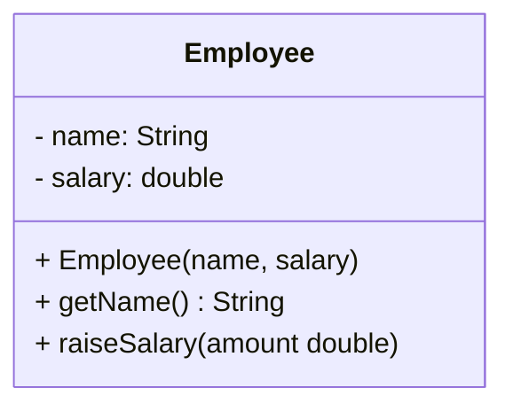
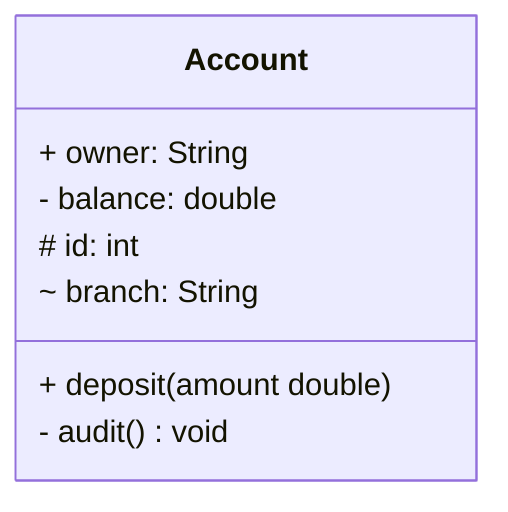
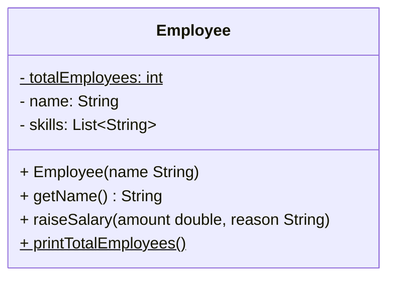
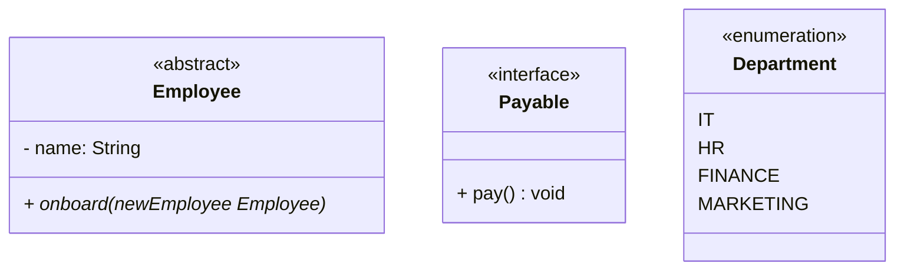
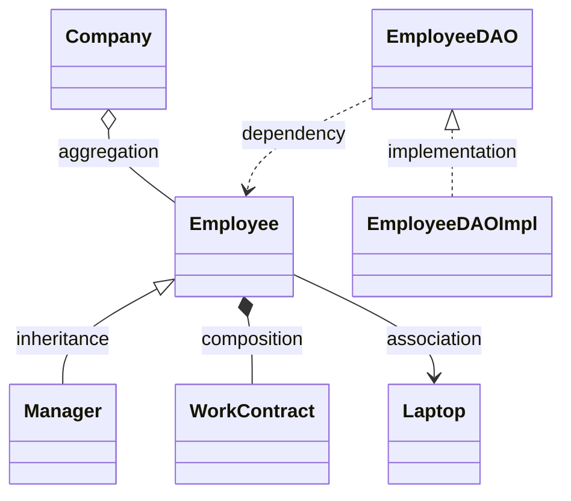
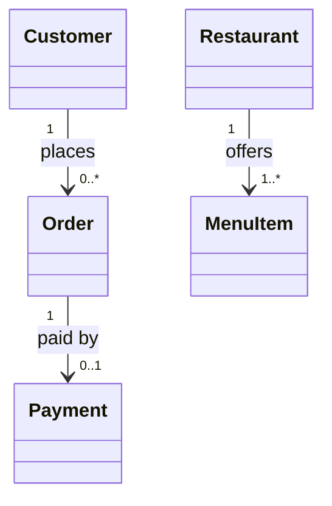
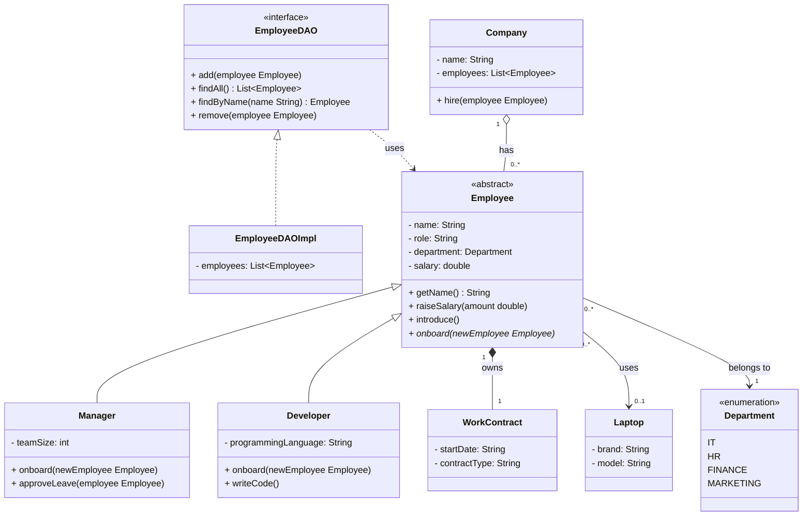

# Mermaid Class Diagram Cheat Sheet

A class diagram is the blueprint of an object-oriented system, drawn **before** you write the code: which classes exist, what fields and methods each one has, and how they connect. Mermaid lets you write that diagram as plain text. GitHub, VS Code (with a Mermaid preview extension) and [mermaid.live](https://mermaid.live) render it as a picture.

Every example uses the Employee system from the OOP lesson. In a Markdown file, put the diagram inside a code fence tagged `mermaid`.

# 📑 Table of Contents
- [1. Start a Class Diagram](#1-start-a-class-diagram)
- [2. Visibility Symbols](#2-visibility-symbols)
- [3. Fields, Methods and Types](#3-fields-methods-and-types)
- [4. Abstract Classes, Interfaces and Enums](#4-abstract-classes-interfaces-and-enums)
- [5. Relationship Arrows](#5-relationship-arrows)
- [6. Association, Aggregation or Composition?](#6-association-aggregation-or-composition)
- [7. Inheritance: Abstract Class or Interface?](#7-inheritance-abstract-class-or-interface)
- [8. Multiplicity](#8-multiplicity)
- [9. From Java Code to Diagram Line](#9-from-java-code-to-diagram-line)
- [10. Putting It All Together](#10-putting-it-all-together)
- [Quick Syntax Reference](#quick-syntax-reference)

---

## 1. Start a Class Diagram

Every diagram starts with the keyword `classDiagram`. A class is a box with three sections: the **name** on top, the **fields** in the middle and the **methods** at the bottom. Mermaid tells fields and methods apart by the parentheses — a member with `()` is a method.

| Section | Holds | Example |
|---|---|---|
| Name | The class name | `class Employee` |
| Fields | The object's data | `- salary: double` |
| Methods | The object's behavior | `+ raiseSalary(amount double)` |



> Constructors are listed with the methods, written like a method without a return type: `+ Employee(name, salary)`.

---

## 2. Visibility Symbols

A one-character prefix in front of a field or method says who may use it. It maps straight onto the Java access modifier.

| Symbol | Java keyword | Meaning | Example |
|---|---|---|---|
| `+` | `public` | accessible from anywhere | `+ getName() String` |
| `-` | `private` | accessible only inside this class | `- salary: double` |
| `#` | `protected` | this class and all its subclasses | `# id: int` |
| `~` | *(no keyword)* | package-private — the same package only | `~ branch: String` |



> In practice class diagrams almost only use `+` and `-`: private fields, public methods. `#` and `~` rarely show up in basic OOP diagrams.

---

## 3. Fields, Methods and Types

Write a field as `visibility name: Type` and a method as `visibility name(parameters) ReturnType`. Static and abstract members are marked with a symbol at the **very end** of the line.

| What | Syntax | Example |
|---|---|---|
| Field | `visibility name: Type` | `- salary: double` |
| Method | `visibility name(params) ReturnType` | `+ getName() String` |
| Constructor | `+ ClassName(params)` | `+ Employee(name String)` |
| Parameter | `name Type`, or just `name` | `+ raiseSalary(amount double)` |
| Generic type | `~` instead of `<` and `>` | `- skills: List~String~` |
| Static member | `$` at the end | `- totalEmployees: int$` |
| Abstract method | `*` at the end | `+ onboard(newEmployee Employee)*` |



> Pick one style for types and stay with it. This sheet uses `name: Type` for fields and a trailing return type for methods, as in the OOP lesson. Generics need the tilde because angle brackets would be read as part of the diagram syntax.

---

## 4. Abstract Classes, Interfaces and Enums

A label in double angle brackets as the **first line inside the class box** says what kind of type it is. Enum constants are listed one per line, with no types.

| Label | Meaning | Java |
|---|---|---|
| `<<abstract>>` | cannot be instantiated; every subclass must fill in the abstract methods | `abstract class` |
| `<<interface>>` | a pure contract — defines what, not how | `interface` |
| `<<enumeration>>` | a fixed set of named constants | `enum` |



> An abstract method is marked with `*` at the end, so the label and the method together tell the whole story: the class is a template, and `onboard()` is the gap each subclass fills in.

---

## 5. Relationship Arrows

A line between two class names is a relationship, and the arrow style says which kind.

| Relationship | Arrow | Java | Reads as |
|---|---|---|---|
| Inheritance | `<\|--` | `extends` | "is-a" |
| Implementation | `<\|..` | `implements` | signs the contract |
| Aggregation | `o--` | field; the parts are created outside and passed in | has-a (weak): the parts survive without the whole |
| Composition | `*--` | field; the part is created inside the parent's constructor | owns (strong): the part cannot exist without the whole |
| Association | `-->` | passed as a method parameter, not stored | uses |
| Dependency | `..>` | appears in method signatures | depends on |



> - The triangle of `<|--` and `<|..` points at the **parent or the interface**: `Employee <|-- Manager` means Manager inherits from Employee.
> - The diamond of `o--` and `*--` sits on the side of the **whole**.
> - A solid line is a structural link, a dashed line is a looser one.
> - Add a label after a colon: `Company o-- Employee : has`.

---

## 6. Association, Aggregation or Composition?

These three are easy to mix up. Ask three questions: is the other object stored as a field, who creates it, and can it exist alone?

| | Association | Aggregation | Composition |
|---|---|---|---|
| Keyword | uses | has-a | owns |
| Arrow | `-->` | `o--` | `*--` |
| Stored as a field? | No — a parameter only | Yes — a collection field | Yes — a single field |
| Created by | someone else | outside, then passed in | inside the parent's constructor |
| Can exist alone? | Yes | Yes | No |
| Strength | weakest | medium | strongest |
| Example | Employee uses a Laptop | Company has Employees | Employee owns a WorkContract |

> **Rule of thumb:** a permanent connection is a field, a temporary one is a parameter.
>
> The course material draws a parameter-only use as association (`-->`), while strict UML would call that a dependency (`..>`). Follow whichever your course or team uses, but be consistent.

---

## 7. Inheritance: Abstract Class or Interface?

Both are drawn with a triangle arrow, but the line style differs. Use the **"is-a" test** first: if "A is a B" is true, inheritance fits. A Manager is an Employee, but a Company is not an Employee, so that link is composition or aggregation.

| | Abstract class | Interface |
|---|---|---|
| Arrow | `<\|--` (solid) | `<\|..` (dashed) |
| Java keyword | `extends` | `implements` |
| Can have fields? | Yes | No (constants only) |
| Can have concrete methods? | Yes | Yes (`default` methods) |
| How many per class? | One parent only | As many as you like |
| Use when | sharing code between closely related classes | defining a capability any class can have |

> "Is-a" with shared code is an abstract class (`Circle` is a `Shape`). A "can-do" capability is an interface (`Manager` can be `Payable`).

---

## 8. Multiplicity

Multiplicity says how many objects of one class connect to how many of the other. Put it in **double quotes** next to the class it describes, one on each end:

```text
Customer "1" --> "0..*" Order : places
```

Read it left to right (*one Customer places zero or more Orders*) and right to left (*each Order belongs to exactly one Customer*).

| Notation | Meaning | Example in plain language |
|---|---|---|
| `1` | exactly one | every Order belongs to exactly one Customer |
| `0..1` | zero or one | an Order may or may not have a Payment |
| `1..*` | one or more | a Restaurant has at least one MenuItem |
| `0..*` | zero or more | a Customer may have placed no orders yet |



> Without multiplicity an arrow only says "these are connected". With it, the diagram answers real questions: can a customer have several orders, and can an order exist without a payment? Every value should come from a real rule in the system, not a guess.

---

## 9. From Java Code to Diagram Line

Going from code to diagram is mostly a lookup. Here is how the Employee code in the OOP lesson translates.

| Java code | Diagram line |
|---|---|
| `private String name;` | `- name: String` |
| `public double getSalary()` | `+ getSalary() double` |
| `private static int totalEmployees;` | `- totalEmployees: int$` |
| `public abstract void onboard(Employee e);` | `+ onboard(e Employee)*` |
| `private List<Employee> employees;` | `- employees: List~Employee~` |
| `class Manager extends Employee` | `Employee <\|-- Manager` |
| `class EmployeeDAOImpl implements EmployeeDAO` | `EmployeeDAO <\|.. EmployeeDAOImpl` |
| `private List<Employee> employees;` filled by `hire(employee)` | `Company o-- Employee` |
| `this.contract = new WorkContract(...)` in the constructor | `Employee *-- WorkContract` |
| `public void use(Laptop laptop)` | `Employee --> Laptop` |
| `private Department department;` (an enum) | `Employee --> Department` |

---

## 10. Putting It All Together

The whole Employee Management System in one diagram: an abstract Employee with two subclasses, an enum, an interface with its implementation, and all three kinds of connection with multiplicities.



> Draw a diagram like this **before** you code. A missing class or a wrong arrow is cheap to fix on paper and expensive to fix in code.

---

## Quick Syntax Reference

| Syntax | Meaning |
|---|---|
| `classDiagram` | the first line of every diagram |
| `+` `-` `#` `~` | public, private, protected, package-private |
| `$` at the end / `*` at the end | static / abstract |
| `List~Employee~` | generics use tildes, not angle brackets |
| `<<abstract>>` `<<interface>>` `<<enumeration>>` | the first line inside the class box |
| `A <\|-- B` / `A <\|.. B` | B extends A / B implements A |
| `A o-- B` / `A *-- B` | aggregation / composition |
| `A --> B` / `A ..> B` | association / dependency |
| `A "1" --> "0..*" B : label` | multiplicities and a label |
